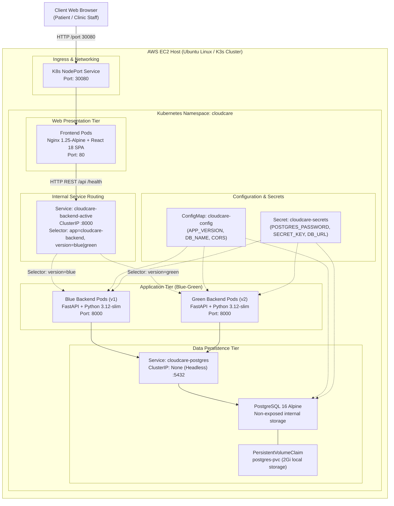
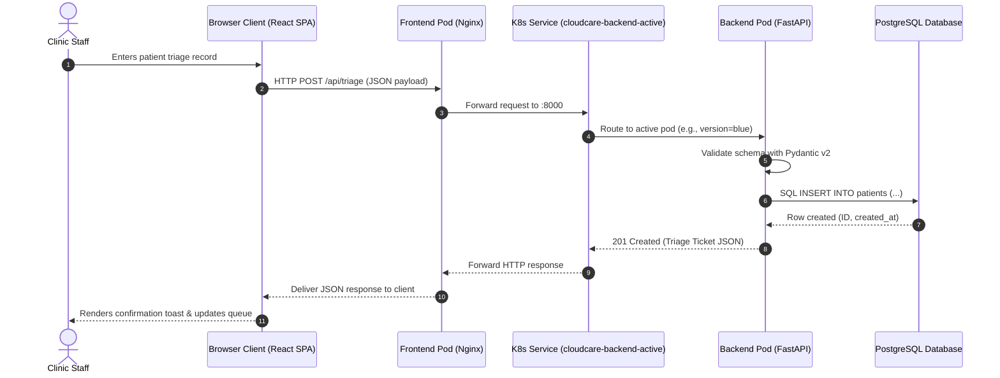
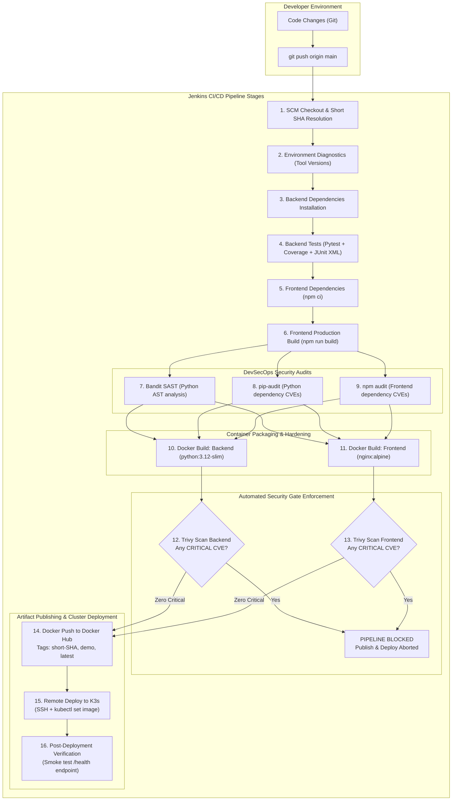
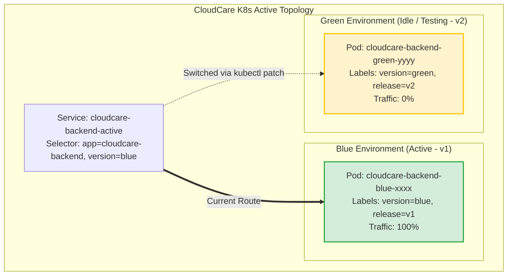
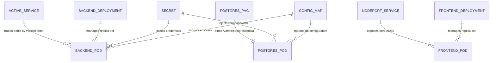

# CloudCare System Architecture

This document outlines the architectural blueprints, communication flows, component topologies, and deployment models powering the CloudCare platform.

---

## 1. Overall System Architecture

The CloudCare platform is structured around a decoupled, three-tier cloud-native model deployed on a Kubernetes cluster (K3s) hosted on an AWS EC2 Ubuntu instance.



---

## 2. Request / Response Data Flow

This diagram illustrates the lifecycle of a patient queue request through the presentation, application, and persistence tiers:



---

## 3. CI/CD Pipeline Automation Flow

The continuous integration and continuous deployment pipeline is executed by Jenkins (hosted on a Windows host runner), pushing tested and scanned container artifacts to Docker Hub and applying state changes to K3s via secure SSH.



---

## 4. Blue-Green Deployment Topology

Blue-Green deployment ensures zero downtime and instant recovery. The active service selector switches between the two deployments seamlessly:



### Switching Mechanism:
```powershell
# Patching service selector atomically in Kubernetes:
kubectl patch service cloudcare-backend-active -n cloudcare --type merge -p '{"spec":{"selector":{"app":"cloudcare-backend","version":"green"}}}'
```

---

## 5. Component Relationship Diagram


